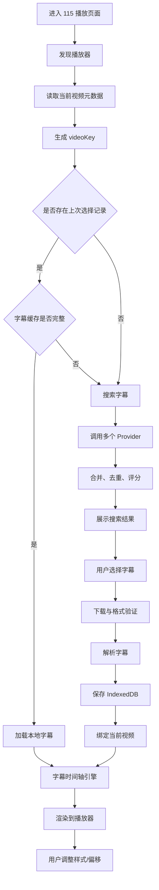
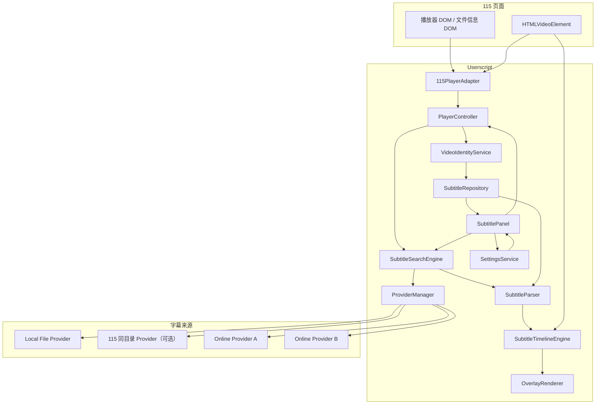

# 115 网页播放器字幕助手（Tampermonkey）技术设计书

> 文档版本：1.0.0  
> 状态：工程设计基线（Implementation Baseline）  
> 目标形态：Tampermonkey / 油猴 Userscript  
> 开发语言：TypeScript  
> 目标平台：桌面版 Chromium 浏览器优先，兼容性逐步扩展  
> 文档用途：产品需求、技术架构、模块契约、数据结构、开发计划、测试与 AI 编程执行规范

---

## 1. 项目概述

### 1.1 项目目标

开发一个运行在 115 网页播放页面中的油猴脚本，为网页播放器增加独立的字幕搜索、选择、显示、样式控制和本地缓存能力。脚本不修改 115 服务端，不要求用户安装独立 Chrome 扩展，也不依赖单独部署的后端服务。

用户在 115 网页中播放视频时，脚本尝试识别当前视频文件名、文件 ID、时长等可从页面正常访问的信息，从文件名中提取番号，按番号搜索字幕。用户选择字幕后，脚本下载并解析字幕，在播放器上方绘制字幕；同时把原始字幕文件及解析信息保存在浏览器 IndexedDB 中。再次播放同一文件时，优先恢复此前选择的本地缓存字幕。

### 1.2 产品目标

1. 自动发现 115 页面中的当前播放器和播放视频。
2. 尽可能自动读取当前视频文件名，并提取番号。
3. 支持手动修正番号，避免文件名识别失败导致无法搜索。
4. 通过可插拔 Provider 接入多个字幕来源。
5. 支持搜索、筛选、排序、预览、选择和下载字幕。
6. 支持本地导入字幕，不依赖在线字幕服务也可以使用。
7. 支持在播放器上叠加字幕，并跟随视频时间轴同步。
8. 支持字幕位置、颜色、字体、大小、描边、背景、透明度及时间偏移设置。
9. 将已选字幕缓存到本地；下次播放时按文件身份恢复字幕。
10. 提供缓存查看、删除、容量统计和清理能力。
11. 对播放器重建、视频切换、暂停、快进、快退、全屏等行为保持稳定。
12. 所有在线字幕源均可独立启停、替换或新增，不让某一个来源绑死核心架构。

### 1.3 非目标

第一阶段不做以下内容：

- 不实现视频下载、解密、破解或提取 115 视频直链。
- 不绕过登录、验证码、访问控制、付费限制或字幕站的反自动化措施。
- 不修改 115 播放器的播放协议或服务端数据。
- 不保证任意网页播放器、移动端播放器或所有 115 页面形态都能适配。
- 不在 MVP 阶段完整复刻 ASS 的全部动画、卡拉 OK 和高级排版能力。
- 不默认把字幕上传到云端；缓存仅保存在用户浏览器本地。
- 不把番号识别结果等同于字幕版本的准确匹配，最终匹配应由用户确认或高置信度规则决定。

### 1.4 设计原则

- **适配层隔离**：115 DOM 结构变化只影响 PlayerAdapter，不影响字幕引擎。
- **来源可插拔**：搜索网站以 Provider 插件形式存在。
- **本地优先**：优先加载用户已选缓存，再考虑在线搜索。
- **安全渲染**：字幕内容默认作为文本显示，不把外部字幕直接当 HTML 执行。
- **渐进增强**：先支持 SRT/VTT，再增加 ASS/SSA。
- **容错优先**：一个 Provider 失败不能阻断其他 Provider；缓存损坏不能阻止用户重新搜索。
- **真实验证**：不预设 115 的具体 DOM 选择器、播放器容器、文件名接口或内部 API，必须用目标页面实测确认。

---

## 2. 用户场景与核心流程

### 2.1 主要用户场景

**场景 A：第一次播放某个视频**

1. 用户打开 115 网页播放页面。
2. 脚本识别播放器，读取当前文件元数据。
3. 脚本解析文件名中的番号。
4. 脚本查询本地缓存。
5. 未命中时，用户点击字幕按钮或开启自动搜索。
6. 搜索引擎并发调用已启用的字幕 Provider。
7. 搜索结果按番号、语言、标题、时长和来源信息排序。
8. 用户选择某条字幕。
9. 脚本下载字幕、验证格式、解析时间轴并写入 IndexedDB。
10. 字幕渲染器开始按照视频当前时间显示字幕。

**场景 B：再次播放已有视频**

1. 脚本识别当前视频身份 `videoKey`。
2. 查询 `videoRecords` 是否记录了上次所选字幕。
3. 检查所选字幕记录是否存在且数据完整。
4. 命中后直接加载，不重复发起在线请求。
5. 恢复该视频专属的时间偏移等设置。

**场景 C：同一番号存在多个字幕版本**

1. 搜索结果出现多个语言、翻译版本或压制版本。
2. 用户查看来源、语言、标题、文件格式、时长和文件大小等信息。
3. 用户选择正确版本。
4. 此次选择与当前 `videoKey` 绑定，而不是只绑定番号。

**场景 D：当前视频无法识别番号**

1. 显示“未识别番号”。
2. 用户可以手动输入、修改或粘贴番号。
3. 手动输入的番号在当前视频记录中保存。
4. 用户仍然可以通过本地字幕导入功能播放字幕。

**场景 E：字幕网站不可用**

1. 在线 Provider 返回失败或超时。
2. 搜索引擎保留其他 Provider 成功返回的结果。
3. 用户可以导入本地字幕或播放已有缓存。
4. 错误信息明确指出是哪个来源失败，不显示误导性的“没有字幕”。

### 2.2 核心流程图



---

## 3. 技术选型与运行模型

### 3.1 技术栈

| 层次 | 推荐方案 | 说明 |
|---|---|---|
| 脚本运行 | Tampermonkey | 通过 Userscript 注入页面 |
| 语言 | TypeScript | 便于定义 Provider、播放器和缓存接口 |
| 构建 | Vite + vite-plugin-monkey | 开发模块化源码，输出单个 `.user.js` |
| UI | 原生 DOM + Shadow DOM | 降低与 115 页面 CSS 冲突；不强制引入 Vue |
| 播放器控制 | HTMLMediaElement | 首选标准 `<video>`，真实页面验证后适配 |
| 字幕渲染 | 自定义 DOM overlay | 支持颜色、位置、大小、描边等样式 |
| 字幕存储 | IndexedDB | 保存原始字幕、解析结果和视频关联 |
| 设置存储 | GM_getValue / GM_setValue 或现代 GM API | 保存体积较小的全局设置；封装统一接口 |
| 跨域网络 | GM_xmlhttpRequest | 仅访问明确配置的字幕服务域名 |
| 测试 | Vitest + 浏览器手工验收 | 单测解析器、匹配器、缓存和时间轴逻辑 |

### 3.2 为什么不采用 Chrome 扩展

本项目目标是油猴脚本，所有功能以 Userscript 方式交付。脚本不需要 Manifest V3、扩展后台 Service Worker、扩展 Popup 或扩展 Options 页面。用户通过 Tampermonkey 安装或更新脚本。

### 3.3 运行上下文

脚本由 Tampermonkey 注入页面。设计上区分三个逻辑区域：

- **Userscript 业务上下文**：保存配置、发起 GM 请求、管理缓存、执行搜索逻辑。
- **页面 DOM 上下文**：查询视频元素、插入字幕容器、监听播放器状态。
- **播放器媒体上下文**：`HTMLVideoElement` 的 `currentTime`、`paused`、`playbackRate`、`duration` 等媒体状态。

默认不使用 `unsafeWindow`，不读取 115 页面内部未公开对象，不调用未知内部接口。只有在实测证明文件名等必要信息无法从 DOM 或用户交互获得，并且确有合法、稳定的页面数据接口时，才评估额外桥接方案。

### 3.4 Userscript 元信息设计

以下是开发阶段的模板。`@match` 和 `@connect` 应在确认真实播放域名和字幕服务域名后收紧，不应照抄占位配置。

```javascript
// ==UserScript==
// @name         115 Subtitle Assistant
// @namespace    https://example.invalid/115-subtitle-assistant
// @version      0.1.0
// @description  115 网页播放器字幕搜索、显示与本地缓存
// @run-at       document-idle
// @match        https://115.com/*
// @match        https://*.115.com/*
// @grant        GM_getValue
// @grant        GM_setValue
// @grant        GM_xmlhttpRequest
// @grant        GM_registerMenuCommand
// @grant        GM_addStyle
// @connect      subtitle-provider.example
// ==/UserScript==
```

注意事项：

1. 示例中的 `subtitle-provider.example` 是占位域名，不能当成真实字幕服务。
2. 115 的播放页面可能使用不同域名或路径，需从真实播放页确认 `@match`。
3. 不要使用 `@connect *` 作为默认方案；每个 Provider 的请求域名都应明确登记。
4. 如果使用 Tampermonkey 的现代 `GM.*` Promise API，应统一声明和封装，不能混用后又假设同步返回。
5. 不要默认启用 `@allFrames`。只有确认播放器存在于 iframe 且跨 frame 策略可行时，再单独设计。

---

## 4. 系统架构

### 4.1 逻辑模块



### 4.2 模块职责

| 模块 | 单一职责 | 不应该承担的工作 |
|---|---|---|
| `PlayerAdapter` | 从目标页面发现播放器和可见视频元数据 | 搜索字幕、解析 SRT |
| `PlayerController` | 管理播放器生命周期、视频切换和状态流转 | 解析具体字幕源 HTML |
| `VideoIdentityService` | 归一化文件名、提取番号、生成 `videoKey` | 发网络请求下载字幕 |
| `SubtitleSearchEngine` | 调度 Provider、超时控制、合并去重、评分 | 直接操作 UI DOM |
| `SubtitleProvider` | 对一个来源执行搜索和下载 | 决定全局字幕显示样式 |
| `SubtitleParser` | 把字幕文件解析为统一 Cue 模型 | 读写浏览器数据库 |
| `SubtitleTimelineEngine` | 根据视频时间确定当前活动字幕 | 管理字幕网站请求 |
| `OverlayRenderer` | 安全地把 Cue 绘制到播放器层 | 访问 IndexedDB |
| `SubtitleRepository` | 保存、查询、删除字幕与视频记录 | 修改播放器 DOM |
| `SettingsService` | 读取、校验、保存设置 | 负责字幕搜索排序 |
| `SubtitlePanel` | 展示搜索、选择、设置和缓存 UI | 直接实现 Provider 网络协议 |

### 4.3 依赖方向

依赖应大致从 UI/控制器指向抽象接口，而不是让底层模块依赖 UI：

- UI → Controller / SearchEngine / SettingsService / Repository。
- Controller → PlayerAdapter / VideoIdentityService / Repository / TimelineEngine。
- SearchEngine → Provider 接口 / Matcher。
- Provider → GM Request 封装。
- TimelineEngine → Cue 数据模型。
- OverlayRenderer → Cue 数据模型和样式配置。

禁止 `provider` 直接操作 `document` 或向 UI 写 DOM；禁止 `parser` 依赖 Tampermonkey API。

---

## 5. 115 播放器适配设计

### 5.1 适配目标

适配层需要获取：

- 当前有效的 `<video>` 元素。
- 视频所在播放器容器。
- 可用于插入覆盖层的定位容器。
- 当前文件名（如果页面可见且可访问）。
- 115 文件 ID（如果页面 DOM 或可访问的公开页面数据中存在）。
- 时长、视频尺寸等媒体元数据。
- 播放器是否处于全屏状态。

不要求也不应为了字幕覆盖而获取视频真实下载地址。

### 5.2 真实页面验证优先

在开始编写 115 专用选择器前，必须在用户实际使用的播放页面检查：

1. 页面 URL 和 host。
2. 是否存在 `<video>`，数量是多少。
3. video 是否位于 iframe 或 Shadow DOM。
4. video 的父级层级、播放器根节点和尺寸。
5. 文件名显示在哪个 DOM 节点。
6. 115 文件 ID 是否能从页面可见 DOM 或稳定的数据属性读取。
7. 点击全屏后，`document.fullscreenElement` 指向哪个元素。
8. 切换文件时 video 节点是复用还是销毁重建。

以上信息形成 `docs/115-player-inspection.md`，并记录实测日期和页面类型。不要依据旧版页面截图直接写死选择器。

### 5.3 PlayerAdapter 接口

```typescript
export interface PlayerMetadata {
  platform: "115";
  fileId?: string;
  fileName?: string;
  duration?: number;
  width?: number;
  height?: number;
  sourcePageUrl: string;
}

export interface PlayerContext {
  video: HTMLVideoElement;
  playerRoot: HTMLElement;
  overlayHost: HTMLElement;
  metadata: PlayerMetadata;
}

export interface PlayerAdapter {
  readonly id: string;
  detect(): PlayerContext | null;
  observe(onChange: (context: PlayerContext | null) => void): () => void;
}
```

`detect()` 应当：

- 排除 `display:none`、尺寸接近 0、不可见的预览 video。
- 如果同时存在多个 video，结合尺寸、可见性、播放状态和时长排序。
- 尽可能避免选择广告或缩略预览视频。
- 不要把 `video.currentSrc` 当作稳定的视频身份，它可能包含临时 URL 或令牌。

### 5.4 播放器发现与观察

建议组合使用：

- 页面初始化时主动扫描一次。
- `MutationObserver` 监听播放器相关 DOM 的增加、删除和属性变化。
- `loadedmetadata` 监听媒体元数据就绪。
- `emptied`、`loadstart`、`loadeddata` 识别媒体切换。
- `fullscreenchange` 处理全屏覆盖层。
- 必要时以低频轮询作为兜底，但必须有明确停止条件。

`MutationObserver` 回调只负责触发防抖后的重新检测，不要在其中直接执行字幕搜索或下载。

### 5.5 播放器生命周期状态

```typescript
export type PlayerState =
  | "waiting"
  | "attached"
  | "metadata-ready"
  | "video-changed"
  | "detached"
  | "error";
```

建议行为：

| 事件 | 处理 |
|---|---|
| 首次发现 video | 创建 PlayerContext，绑定事件 |
| `loadedmetadata` | 更新 duration、尺寸，生成/更新 videoKey |
| 文件 ID 或文件名改变 | 认定视频切换，停止旧时间轴并清除旧字幕显示 |
| video 节点被移除 | 取消监听、停止渲染循环、移除覆盖层 |
| 新 video 出现 | 重新挂载并恢复缓存查询 |
| 页面 SPA 路由变化 | 重新扫描，不重复创建全局 UI |
| 页面离开 | 释放 Observer、事件监听、动画帧回调和网络任务 |

### 5.6 全屏处理

自定义字幕覆盖层必须位于当前全屏元素的 DOM 子树内，才能在浏览器原生全屏时显示。

需要区分：

1. **容器全屏**：`fullscreenElement` 是播放器容器或其祖先。可将 overlay 挂载到该元素内部。
2. **video 元素本身全屏**：普通 DOM overlay 无法可靠地覆盖原生全屏 video。此场景应尝试使用原生 `TextTrack` 作为基础字幕后备，或明确提示该全屏模式不支持自定义覆盖层。
3. **网站自定义全屏**：可能只是 CSS 放大容器，通常仍可使用原 overlay，但需要实测。

不得通过未经验证的方式 monkey patch 115 的全屏逻辑。全屏兼容性是阶段 0 的核心验收项。

---

## 6. 视频身份与番号识别

### 6.1 视频身份不能只使用番号

同一个番号可能有多个文件版本、剪辑、分辨率或字幕版本。缓存必须绑定具体视频身份，而不能只按番号做唯一键。

优先级：

1. 稳定且可读取的 115 文件 ID。
2. 文件 ID + 账户作用域（仅在有明确必要且不保存敏感凭据时使用）。
3. 归一化文件名 + 时长 + 文件大小（可获取时）。
4. 归一化文件名 + 时长。
5. 仅文件名（弱身份，需在 UI 中提示）。

不要把播放临时 URL、Cookie、访问令牌或登录态内容写入 `videoKey`。

### 6.2 VideoIdentity 模型

```typescript
export interface VideoIdentity {
  videoKey: string;
  fileId?: string;
  originalFileName?: string;
  normalizedFileName?: string;
  code?: string;
  duration?: number;
  fileSize?: number;
  confidence: "strong" | "medium" | "weak";
  source: "115-dom" | "media-element" | "manual";
}
```

### 6.3 文件名归一化

建议处理：

- 扩展名（`.mp4`、`.mkv`、`.avi`、`.wmv` 等）。
- 全角英数字转半角。
- 大小写统一。
- 空格、下划线、点号、部分连接符归一化。
- 方括号、圆括号中的分辨率、编码、字幕标记保留为辅助信息或单独提取。
- 不要简单删除所有非字母数字字符，否则可能破坏 `FC2-PPV-1234567` 等编号结构。

示例：

```typescript
export function normalizeFileName(input: string): string {
  return input
    .normalize("NFKC")
    .replace(/\.[a-z0-9]{2,5}$/i, "")
    .replace(/[\s_.]+/g, " ")
    .replace(/[\[\]【】（）()]/g, " ")
    .replace(/\s+/g, " ")
    .trim()
    .toUpperCase();
}
```

上述仅为基础归一化，不代表完整番号解析规则。

### 6.4 番号解析器

不应只使用一个通用正则。使用 Parser Registry：

```typescript
export interface CodeParser {
  readonly id: string;
  readonly priority: number;
  match(input: string): boolean;
  parse(input: string): ParsedCode | null;
}

export interface ParsedCode {
  raw: string;
  normalized: string;
  family?: string;
  confidence: number;
}
```

编号解析应覆盖不同格式族，例如：

- 字母前缀 + 连字符 + 数字：`ABC-123`。
- 字母前缀 + 数字：`ABC123`。
- 多段前缀：`FC2-PPV-1234567`。
- 带日期、批次或厂牌前缀的特殊格式。

规则应以配置和测试样例驱动。对歧义编号返回多个候选或低置信度，不要随意选择第一个匹配项。

### 6.5 手动修改

字幕面板必须允许用户：

- 修改自动识别的番号。
- 清空番号。
- 搜索多个候选番号。
- 将手动番号与当前 `videoKey` 绑定。
- 恢复自动识别结果。

手动设置优先级高于自动识别，但只作用于当前视频记录，不应污染其他同番号文件。

---

## 7. 字幕来源与 Provider 体系

### 7.1 来源类型

按扩展能力划分：

1. **Local Provider**：用户选择本地 SRT/VTT/ASS/SSA 文件。
2. **115 Directory Provider（可选）**：如果 115 当前页面已显示同目录文件且可以通过页面正常访问，可在用户允许后查找同名字幕文件。不得假设存在某个未验证接口。
3. **Online Provider**：合法可访问的字幕网站或公开字幕 API。
4. **Manual URL Provider（可选）**：用户提供字幕文件 URL，由安全请求层下载。

### 7.2 Provider 接口契约

```typescript
export type SubtitleFormat = "srt" | "vtt" | "ass" | "ssa" | "unknown";

export interface SubtitleSearchQuery {
  code: string;
  normalizedCode: string;
  fileName?: string;
  duration?: number;
  languagePreferences: string[];
  signal?: AbortSignal;
}

export interface SubtitleSearchResult {
  providerId: string;
  sourceId: string;
  title: string;
  code?: string;
  language?: string;
  format: SubtitleFormat;
  fileSize?: number;
  duration?: number;
  releaseInfo?: string;
  downloadUrl?: string;
  detailUrl?: string;
  rating?: number;
  updatedAt?: number;
  checksum?: string;
  rawMetadata?: Record<string, unknown>;
}

export interface SubtitleDownload {
  bytes: ArrayBuffer;
  fileName: string;
  contentType?: string;
  checksum?: string;
}

export interface SubtitleProvider {
  readonly id: string;
  readonly name: string;
  readonly enabledByDefault: boolean;
  search(query: SubtitleSearchQuery): Promise<SubtitleSearchResult[]>;
  download(result: SubtitleSearchResult, signal?: AbortSignal): Promise<SubtitleDownload>;
  healthCheck?(): Promise<{ ok: boolean; message?: string }>;
}
```

Provider 的职责仅限于该来源的搜索与下载；不允许 Provider 自己写数据库或直接控制播放器。

### 7.3 Provider 配置

每个 Provider 配置：

- 是否启用。
- 显示名称。
- 请求域名白名单。
- 超时时间。
- 并发限制。
- 每分钟最大请求数（按来源设置）。
- 语言偏好。
- 是否参与自动搜索。
- 是否需要用户手动确认。

敏感 Token 不应明文写入项目源码，也不应记录在日志里。若来源要求认证，应使用来源官方支持的授权方式，并向用户说明数据如何保存。

### 7.4 搜索调度策略

- 对启用的 Provider 并发或受限并发搜索。
- 单个 Provider 设置超时和取消能力。
- 使用 `Promise.allSettled` 收集结果，避免一个来源失败导致整体失败。
- UI 逐个展示 Provider 状态：等待中、搜索中、成功、无结果、失败、超时。
- 同一个 Provider 的短时间重复搜索可做请求去重。
- 用户切换视频或关闭面板后，可取消尚未完成的搜索。
- 自动搜索不得无限重试。

### 7.5 结果去重

去重可以使用：

`providerId + sourceId`（同来源唯一）和跨来源复合指纹：

`normalizedCode + language + normalizedTitle + format + durationBucket`。

不同来源即使指向相同字幕也可以保留来源信息，但 UI 可以聚合显示“可能重复”。不要仅根据标题完全相同就删除结果。

### 7.6 不绑定任何特定字幕站

本设计不预设字幕网站名称、接口地址、请求参数或页面结构。开发者确定字幕来源后，需要为每个来源单独实现 Provider，并验证其服务条款、请求方式、跨域请求能力、数据格式和可用性。

---

## 8. 字幕匹配与排序

### 8.1 匹配维度

同一番号可能存在不同剪辑、不同压制组、不同语言或不同时间轴版本。结果评分不能只判断番号是否相等。

建议评分维度：

| 维度 | 建议权重 | 说明 |
|---|---:|---|
| 番号完全匹配 | 40 | 归一化番号一致；不一致应大幅降权或过滤 |
| 文件标题相似度 | 15 | 去除常见分辨率、编码、标签后比较 |
| 视频时长接近 | 20 | 有双方时长数据才评分 |
| 用户语言偏好 | 10 | 简体、繁体、英文等 |
| 版本/压制信息匹配 | 10 | 来源提供 release 信息时参与 |
| 来源可靠度 | 5 | 可按用户反馈和历史成功率维护 |

分数范围可归一化到 0–100。权重应放在配置中，方便未来调整。

### 8.2 置信度分级

- `90–100`：高置信度，可在用户启用自动选择时自动推荐；不应默认自动下载。
- `70–89`：较高置信度，排在前面并提示用户确认。
- `40–69`：低置信度，展示但不自动推荐。
- `<40`：默认折叠或过滤，可由用户打开“显示低匹配结果”。

如果结果没有时长或版本数据，不能把缺失字段当作匹配成功，需按可用字段计算并说明评分依据。

### 8.3 用户反馈

用户可以标记：

- 匹配正确。
- 时间轴不匹配。
- 字幕语言错误。
- 字幕内容错误。
- 文件损坏。

反馈只用于本地排序偏好，默认不上传。

---

## 9. 字幕格式与解析

### 9.1 第一阶段支持范围

| 格式 | MVP | 后续 | 实现方式 |
|---|---|---|---|
| SRT | 必须 | 持续完善 | 自定义解析器 |
| WebVTT | 必须 | 持续完善 | 自定义解析器 |
| ASS | 可选基础解析 | 完整样式 | 评估 libass WASM 等成熟实现 |
| SSA | 可选基础解析 | 完整样式 | 与 ASS 共享解析路径 |
| ZIP 内字幕 | 不必 | 后续 | 安全解压，只提取受支持文件 |

> 当前实现（2026-11-03）：SRT、VTT 已实现解析；ASS/SSA 仅按扩展名识别，
> `parseSubtitle()` 会返回 `UNSUPPORTED_FORMAT`，尚未实现基础解析或完整渲染。
> 相关优化项见 `docs/optimization-backlog.md`。

### 9.2 统一 Cue 模型

```typescript
export interface SubtitleCue {
  id: number;
  startMs: number;
  endMs: number;
  text: string;
  segments?: SubtitleSegment[];
  region?: CueRegion;
  sourceOrder: number;
}

export interface SubtitleSegment {
  text: string;
  bold?: boolean;
  italic?: boolean;
  underline?: boolean;
  color?: string;
}

export interface CueRegion {
  vertical?: "top" | "middle" | "bottom";
  horizontal?: "left" | "center" | "right";
  line?: number | string;
}

export interface ParsedSubtitle {
  format: SubtitleFormat;
  encoding: string;
  cues: SubtitleCue[];
  warnings: string[];
}
```

时间统一使用毫秒整数，避免秒的小数累积误差。渲染时再转换为秒或与 `video.currentTime * 1000` 比较。

### 9.3 SRT 解析要求

解析器需支持：

- 标准序号和时间轴。
- `00:00:01,200 --> 00:00:03,400` 时间格式。
- 多行字幕。
- 文件末尾没有空行。
- BOM。
- 空白行和 CRLF/LF。
- 可选的 `<i>`、`<b>`、`<u>` 等常见标签的安全处理。
- 错误块跳过并记录 warnings，不因单块异常导致整份字幕失败。

### 9.4 VTT 解析要求

支持：

- `WEBVTT` 文件头。
- cue ID。
- 时间轴和 cue settings。
- 多行文本。
- 常见内联标记。
- `NOTE` 块忽略。
- 时间戳格式校验。

### 9.5 ASS/SSA 解析策略

ASS/SSA 不等同于普通文本字幕。它具有 Style、Event、Position、Alignment、Outline、Shadow、Margin、颜色、动画和卡拉 OK 等功能。

建议分两层实现：

1. **基础兼容**：解析事件时间、文本、换行和有限格式标签，将不支持的样式降级为普通文本并告知用户。
2. **完整渲染**：后续评估集成成熟的 libass WASM 渲染器。集成前必须核查依赖体积、运行性能、许可证、字体加载、浏览器兼容性以及油猴打包方式。

不能宣称第一版“支持 ASS”却只删除格式标签显示纯文本。应在 UI 中区分“ASS 基础模式”和“ASS 完整渲染模式”。

### 9.6 编码处理

下载后先检查 BOM 和 UTF-8 解码结果。必要时尝试 GB18030 等常见编码。解析失败时允许用户选择编码重新解析。

不得仅因为解码出现替换字符就静默覆盖原始数据。原始字幕字节应保留，以便重新解析。

### 9.7 字幕文本安全

- 默认用 `textContent` 渲染。
- 不直接使用 `innerHTML = cue.text`。
- 如果支持有限标签，先解析为白名单 Segment，再创建 DOM 节点。
- 颜色值必须通过 CSS 颜色解析或正则白名单验证。
- 不允许字幕内容插入任意 URL、脚本、事件处理器或 CSS。
- 不将字幕文本交给 `eval`、`Function` 或 HTML 模板执行。

---

## 10. 时间轴引擎与同步

### 10.1 目标

时间轴引擎负责根据当前视频时间找出应显示的字幕 Cue，并处理 seek、pause、playbackRate、字幕延迟和重叠 Cue。

### 10.2 时间偏移定义

统一约定：

- `offsetMs = 0`：字幕按原时间播放。
- `offsetMs > 0`：字幕整体延后显示。
- `offsetMs < 0`：字幕整体提前显示。

计算公式：

`subtitleTimeMs = video.currentTime * 1000 - offsetMs`

举例：offset 为 `+2000` 时，视频播放到 12 秒，字幕引擎查询 10 秒位置的 Cue，表现为字幕延后 2 秒。

### 10.3 查询算法

字幕 Cue 按 `startMs` 排序。基础实现使用二分查找定位最后一个 `startMs <= currentTime` 的 Cue，再向前检查可能重叠的 Cue。若需要同时显示多行，应返回所有满足 `startMs <= t < endMs` 的 Cue，并按 sourceOrder 或层级排序。

对大量字幕，避免每帧从头遍历整个数组。

### 10.4 刷新机制

优先级建议：

1. 浏览器支持时使用 `HTMLVideoElement.requestVideoFrameCallback`，在视频帧推进时刷新。
2. 不支持时使用 `requestAnimationFrame`，仅在视频播放时运行。
3. 暂停时根据当前时间立即渲染一次，之后停止连续刷新。
4. 同时监听 `seeked`、`timeupdate`、`playing`、`pause`、`ratechange`、`ended`。
5. 视频切换或组件销毁时必须取消旧回调。

不要在 `timeupdate` 中做复杂解析或数据库请求；Cue 应预先解析并载入内存。

### 10.5 边界处理

- `currentTime` 小于 0 或非有限值：不显示字幕。
- 当前时间超过最后一个 Cue：清空字幕。
- 视频暂停：保留当前时刻有效字幕。
- seek：立即重新计算，而不是等待下一次轮询。
- 播放速度变化：使用媒体 currentTime，不自行累加时间，因此自然适配倍速。
- ended：按产品配置选择清空字幕或保留最后状态，默认清空。
- 相邻 Cue 有重叠：按解析器顺序或 Cue 层级处理，不应随机闪烁。

### 10.6 TimelineEngine 接口

```typescript
export interface SubtitleTimelineEngine {
  load(cues: SubtitleCue[]): void;
  setOffset(offsetMs: number): void;
  update(videoTimeSeconds: number): SubtitleCue[];
  clear(): void;
  dispose(): void;
}
```

---

## 11. 字幕覆盖层与播放器 UI

### 11.1 Overlay 设计

建议将字幕覆盖层挂载到 `overlayHost`，并用 Shadow DOM 隔离脚本 CSS，避免被 115 全局样式影响。

DOM 结构示意：

```text
playerRoot
├── video
├── 115 原有控制层
└── userscript-subtitle-root
    └── #shadow-root
        ├── subtitle-stage
        │   ├── subtitle-line
        │   └── subtitle-line
        └── subtitle-control-button
```

Overlay 必须：

- 默认 `pointer-events: none`，不影响播放器点击。
- 设置足够高但合理的层级。
- 不遮挡播放器控制栏，必要时在控制栏显示时调整底部安全区。
- 在视频尺寸变化、容器 resize、全屏变化时更新布局。
- 只渲染活动 Cue，不创建整个字幕文件的 DOM 节点。

### 11.2 样式设置项

| 设置 | 默认值 | 建议范围 |
|---|---|---|
| 字体大小 | 32 px | 16–64 px |
| 字体颜色 | `#FFFFFF` | 任意合法颜色 |
| 字体 | 系统无衬线字体 | 系统字体白名单 |
| 字体粗细 | 600 | 300–900 |
| 描边颜色 | `#000000` | 任意合法颜色 |
| 描边宽度 | 2 px | 0–6 px |
| 阴影 | 开启 | 开/关、强度 |
| 背景 | 关闭 | 透明度 0–80% |
| 水平位置 | 居中 | 左/中/右/自定义 |
| 垂直位置 | 距底部 8% | 0–30% 或拖动定位 |
| 最大宽度 | 90% | 50–100% |
| 行间距 | 1.2 | 1.0–2.0 |
| 字幕延迟 | 0 ms | -10,000 至 +10,000 ms |
| 显示模式 | 自定义覆盖 | 原生轨道后备（如可用） |

位置建议内部使用归一化百分比，例如 `x=50, y=88`，而不是固定像素。播放器尺寸变化时按百分比重新计算。

### 11.3 拖动定位

- 在字幕设置面板中开启“拖动调整位置”后，字幕层可接收 Pointer Events。
- 拖动时记录相对播放器容器的百分比位置。
- 松开后保存位置。
- 正常观看时字幕层应恢复 `pointer-events: none`。
- 不应在默认状态下阻止播放器点击或拖动进度条。

### 11.4 字幕控制面板

面板建议分为四个 Tab：

1. **字幕**：启用/关闭、当前字幕、搜索、搜索结果、导入本地文件。
2. **样式**：大小、颜色、描边、背景、字体、位置、预览。
3. **同步**：延迟滑块、提前/延后快捷按钮、重置。
4. **缓存**：当前视频缓存、所有字幕缓存、占用空间、删除和清理。

面板应提供加载状态、空状态、错误状态和无结果状态。搜索失败和搜索无结果必须区分。

### 11.5 预览

样式面板提供独立的假字幕预览，调整时实时生效，不必等待视频中的下一句字幕。预览内容不得写入真实字幕缓存。

### 11.6 快捷键

建议默认快捷键可配置，且避免与 115 原有快捷键冲突：

- 开关字幕面板。
- 开关当前字幕。
- 字幕提前 500 ms。
- 字幕延后 500 ms。
- 重置同步偏移。

仅当焦点不在 input、textarea、select、contenteditable 中时处理快捷键。提供快捷键总开关和冲突提示。

---

## 12. 本地缓存与数据持久化

### 12.1 存储方案

- IndexedDB：字幕原始内容、解析 Cue、视频关联、搜索历史和本地反馈。
- GM 存储：少量全局设置、数据库迁移标记或脚本级偏好。
- 不使用 localStorage 保存完整字幕。

建议使用 Dexie.js 简化 IndexedDB，或使用原生 IndexedDB 封装。若为了脚本体积选择原生实现，必须封装事务、版本升级和错误处理，不能在业务模块里散落 IndexedDB 请求。

### 12.2 数据库

数据库名：`115SubtitleAssistantDB`。初始版本 `1`。

建议 Store：

#### `subtitles`

| 字段 | 类型 | 说明 |
|---|---|---|
| `id` | string | 主键 UUID |
| `videoKey` | string | 关联视频身份 |
| `code` | string | 归一化番号 |
| `providerId` | string | 来源 ID，如 `local` |
| `sourceId` | string | 来源侧记录 ID，可选 |
| `title` | string | 字幕标题/文件名 |
| `language` | string | 语言代码或显示名称 |
| `format` | string | srt/vtt/ass/ssa |
| `rawBlob` | Blob | 原始字幕文件 |
| `encoding` | string | 解析使用的编码 |
| `cues` | array | 解析后的 Cue |
| `cueCount` | number | Cue 数量 |
| `checksum` | string | 内容摘要，可选 |
| `createdAt` | number | 创建时间 |
| `lastUsedAt` | number | 最后使用时间 |
| `parserVersion` | number | 解析器版本 |
| `isFavorite` | boolean | 是否收藏 |

索引建议：`videoKey`、`code`、`providerId`、`lastUsedAt`、`checksum`。

#### `videoRecords`

| 字段 | 类型 | 说明 |
|---|---|---|
| `videoKey` | string | 主键 |
| `fileId` | string | 115 文件 ID（可选） |
| `fileName` | string | 原始文件名 |
| `normalizedFileName` | string | 归一化文件名 |
| `code` | string | 当前使用番号 |
| `codeSource` | string | auto/manual |
| `selectedSubtitleId` | string | 上次所选字幕 |
| `subtitleEnabled` | boolean | 是否恢复时自动显示 |
| `offsetMs` | number | 当前视频字幕偏移 |
| `positionOverride` | object | 当前视频专属位置覆盖，可选 |
| `lastPlayedAt` | number | 最近播放时间 |
| `updatedAt` | number | 更新时间 |

#### `settings`

| 字段 | 类型 | 说明 |
|---|---|---|
| `key` | string | 主键 |
| `value` | object | 配置值 |
| `updatedAt` | number | 更新时间 |

#### `providerStates`（可选）

保存来源启用状态、最近错误时间、成功率统计和请求节流状态。不得保存不必要的账户凭证。

### 12.3 SubtitleRecord TypeScript 模型

```typescript
export interface SubtitleRecord {
  id: string;
  videoKey: string;
  code: string;
  providerId: string;
  sourceId?: string;
  title: string;
  language?: string;
  format: SubtitleFormat;
  rawBlob: Blob;
  encoding: string;
  cues: SubtitleCue[];
  cueCount: number;
  checksum?: string;
  createdAt: number;
  lastUsedAt: number;
  parserVersion: number;
  isFavorite: boolean;
}
```

### 12.4 缓存命中流程

1. 根据当前页面生成 `videoKey`。
2. 查询 `videoRecords`。
3. 如果存在 `selectedSubtitleId`，查询对应字幕记录。
4. 检查 `videoKey` 一致、Cue 数量合理、解析器版本可兼容。
5. 命中后载入 Cue、更新时间并显示字幕。
6. 如果选中字幕不存在或损坏，清理失效引用，再进入搜索流程。

### 12.5 缓存策略

建议默认参数：

- 软容量上限：200 MB，可配置。
- 缓存保留：不设置必须到期时间；提供“超过 90 天未使用可清理”的建议策略。
- LRU：优先清理长时间未使用且非收藏、非当前选中的字幕。
- 收藏字幕和当前视频使用中的字幕不自动清理。
- 单个字幕文件大小限制：建议默认 20 MB，可配置。

容量不是绝对上限，浏览器实际可用额度受设备和浏览器策略影响。可通过 `navigator.storage.estimate()` 查询估算值；如使用 `navigator.storage.persist()`，必须把结果视为浏览器授权情况而非永久保证。

### 12.6 数据库升级

- 所有升级使用版本号和明确 migration。
- 不在数据库升级时静默删除用户字幕。
- 迁移前尽量保证事务原子性。
- `parserVersion` 变化不一定要重下载原始字幕，可从 `rawBlob` 重新解析。
- 数据库损坏时提供清理数据库和重新导入的恢复入口。

### 12.7 缓存去重

同一字幕可由多个来源返回。可以按 checksum 检测完全相同文件，避免重复保存 Blob；但应保留不同 Provider 的来源元数据或来源映射，不要把来源信息丢掉。

同一番号在缓存中只保留一份字幕：

- 用户使用一条**新**字幕（在线下载或本地导入）后，自动删除该番号的其他缓存记录，只保留刚使用的这条；UI 通过 toast 提示替换数量。
- 分组按归一化番号（去空白、统一大写）进行，与手动「缓存字幕去重」一致。
- 被删除记录若正被当前视频引用，选中引用重定向到新记录；若被其他视频引用则清除引用，绝不把其他视频的字幕挂到当前视频上。
- 手动「缓存字幕去重」仍按 `createdAt` / `lastUsedAt` 保留最新的一条，作为批量清理入口。

### 12.8 跨播放域名元数据同步（GM）

`115vod.com` 与 `115.com` 是不同 origin，IndexedDB 无法共享；Tampermonkey 的 GM 存储对同一脚本跨 origin 共享，因此只同步元数据。

实现约定：

- GM 键 `metadataSync.v1`，按播放域名分 bucket：
  `{ version, buckets: { [origin]: { updatedAt, subtitles, videos } } }`。
- 每个 origin 只覆盖自己的 bucket；启动时以及每次缓存变更（保存、删除、清空、去重、切换选中）后发布。
-
字幕元数据包含：id、videoKey、code、providerId、sourceId、title、language、format、cueCount、checksum、size、createdAt、lastUsedAt、isFavorite、sourceResult。
- `sourceResult` 只保留重新下载所需字段（providerId、sourceId、title、format、downloadUrl 等），不包含 Blob、Cues 或匹配说明。
- 视频元数据包含：videoKey、code、selectedSubtitleId、offsetMs、subtitleEnabled、updatedAt。
- 读取 GM 数据时逐字段校验；坏数据只丢弃对应条目，不让整个同步功能失效。
- 视频匹配优先精确 `videoKey`，其次按 `id:<pickcode>` 文件 ID 匹配，避免时长舍入差异导致对不上。
- 恢复顺序：本地缓存 → 其他域名中“选中且可重新下载”的缓存 → 自动搜索。
- 本地导入的字幕没有下载地址，远程列表只显示说明，不能自动恢复。
- 远程恢复会等待当前视频 metadata 就绪后再写入 IndexedDB，避免写到弱 `videoKey`。
- 单个 origin 最多同步 500 条字幕和 500 条视频记录，超出按最近使用/更新时间截断。

限制：

- 旧缓存记录在加入该功能前没有 `sourceResult`，只能显示为不可恢复；重新从在线来源使用一次后才会具备恢复能力。
- 下载地址可能过期或来源下线，恢复失败时回退到自动搜索。
- 两个域名的选中状态可能不一致（例如某域名刚替换了同番号字幕）；跨域恢复以另一域名的选中项为准。
- 开发模式下 GM 存储不可用，会回退到按 origin 隔离的 localStorage，无法跨域同步。

---

## 13. 设置体系

### 13.1 全局设置

```typescript
export interface GlobalSettings {
  enabled: boolean;
  autoSearch: boolean;
  autoLoadCachedSubtitle: boolean;
  autoSelectHighConfidence: boolean;
  preferredLanguages: string[];
  defaultFormatOrder: SubtitleFormat[];
  style: SubtitleStyleSettings;
  sync: SubtitleSyncSettings;
  cache: CacheSettings;
  providers: Record<string, ProviderSettings>;
  shortcuts: ShortcutSettings;
  debug: boolean;
}
```

### 13.2 默认设置建议

```typescript
export const DEFAULT_SETTINGS: GlobalSettings = {
  enabled: true,
  autoSearch: false,
  autoLoadCachedSubtitle: true,
  autoSelectHighConfidence: false,
  preferredLanguages: ["zh-CN", "zh-TW", "en"],
  defaultFormatOrder: ["srt", "vtt", "ass", "ssa"],
  style: {
    fontFamily: "Arial, sans-serif",
    fontSize: 32,
    fontWeight: 600,
    color: "#FFFFFF",
    outlineColor: "#000000",
    outlineWidth: 2,
    shadow: true,
    backgroundColor: "#000000",
    backgroundOpacity: 0,
    horizontal: "center",
    xPercent: 50,
    yPercent: 88,
    maxWidthPercent: 90,
    lineHeight: 1.2
  },
  sync: { offsetMs: 0, stepMs: 500 },
  cache: { maxBytes: 200 * 1024 * 1024, cleanupAfterDays: 90 },
  providers: {},
  shortcuts: { enabled: true },
  debug: false
};
```

实际代码需要将可选设置补齐类型定义，并通过 schema 校验处理旧版本和无效数值。

### 13.3 全局样式与单视频覆盖

全局设置作为默认值；视频记录可以只保存用户单独调整的字段。最终配置通过合并得到：

`effectiveSettings = merge(globalSettings, videoOverrides)`

避免每个视频都复制一整份全局样式。

---

## 14. UI/UX 详细设计

### 14.1 播放器入口

播放器上增加一个小型 `CC` 或“字幕”按钮：

- 默认显示在播放器边缘或控制栏可用区域。
- 不阻挡播放/暂停、音量和进度条。
- 点击展开字幕面板。
- 当前已有字幕时显示启用状态。
- 搜索中显示轻量状态提示。

具体挂载位置必须在 115 实机验证，不允许遮挡原生控制按钮。

### 14.2 字幕 Tab

显示内容：

- 当前视频文件名。
- 当前番号及识别来源。
- 手动编辑番号入口。
- 搜索按钮和自动搜索状态。
- Provider 搜索进度。
- 语言筛选。
- 格式筛选。
- 结果排序。
- 搜索结果卡片。
- 本地导入按钮。
- 当前字幕名称和缓存状态。

结果卡片字段：

- 字幕标题。
- 语言。
- 格式。
- 来源。
- 文件大小。
- 时长（如果来源可提供）。
- 匹配分数和主要匹配依据。
- 选择/下载按钮。

### 14.3 样式 Tab

- 字体大小滑块和数值输入。
- 字体颜色选择器。
- 字体与粗细选择。
- 描边颜色与宽度。
- 阴影开关。
- 背景透明度。
- 位置预设和拖动定位。
- 实时预览。
- 恢复默认按钮。

### 14.4 同步 Tab

- 当前 offset 数值。
- -500 ms / +500 ms 快捷按钮。
- 滑块（例如 -10 秒至 +10 秒）。
- 直接输入毫秒或秒。
- 重置为 0。
- 是否保存为当前视频专属设置。

### 14.5 缓存 Tab

- 当前视频是否有缓存。
- 当前选中字幕缓存详情。
- 已缓存字幕列表。
- 占用空间估算。
- 按视频删除。
- 按字幕删除。
- 收藏。
- 清理未使用缓存。
- 清空全部缓存（必须二次确认）。

### 14.6 UI 状态

必须设计以下状态：

- 未检测到播放器。
- 正在检测视频。
- 文件名暂不可用。
- 番号识别成功。
- 番号识别失败。
- 正在读取缓存。
- 缓存命中。
- 正在搜索。
- 部分来源失败。
- 搜索无结果。
- 下载中。
- 解析中。
- 字幕已加载。
- 格式不支持。
- 缓存空间不足。
- 播放器不支持自定义覆盖层。

---

## 15. 网络请求与错误处理

### 15.1 GM Request 封装

所有在线来源统一通过 `GM_xmlhttpRequest` 封装，不能每个 Provider 自己实现一套不一致的超时和错误处理。

封装要求：

- Promise 化。
- 超时控制。
- AbortSignal 取消支持（若底层 API 不支持原生 signal，则封装 abort handle）。
- 请求方法、URL、响应类型白名单。
- 统一 HTTP 错误转换。
- 限制最大响应体。
- 只向 `@connect` 已授权域名发请求。
- 不记录 Cookie、Authorization、Token 或完整敏感 URL。

### 15.2 超时建议

- 搜索请求：每个 Provider 默认 8–12 秒。
- 字幕下载：默认 20–30 秒，按文件大小调整。
- 单次搜索整体等待：可先显示已返回结果，不必等待最慢来源。

这些值应可配置，并在真实 Provider 接入后按实际服务调整。

### 15.3 错误类型

```typescript
export type SubtitleErrorCode =
  | "PLAYER_NOT_FOUND"
  | "VIDEO_METADATA_UNAVAILABLE"
  | "CODE_NOT_FOUND"
  | "PROVIDER_DISABLED"
  | "PROVIDER_TIMEOUT"
  | "PROVIDER_NETWORK_ERROR"
  | "PROVIDER_BAD_RESPONSE"
  | "NO_RESULTS"
  | "DOWNLOAD_FAILED"
  | "FILE_TOO_LARGE"
  | "UNSUPPORTED_FORMAT"
  | "DECODE_FAILED"
  | "PARSE_FAILED"
  | "CACHE_QUOTA_EXCEEDED"
  | "CACHE_READ_FAILED"
  | "CACHE_WRITE_FAILED"
  | "FULLSCREEN_OVERLAY_UNSUPPORTED";
```

### 15.4 日志

- 默认关闭 Debug 日志。
- Debug 模式可输出播放器状态、videoKey 生成方式、Provider 耗时和 parser warnings。
- 不输出 Cookie、Authorization、账号信息、完整播放地址或用户本地文件内容。
- 错误日志应带错误代码、模块、时间和可读说明。

---

## 16. 安全与隐私

### 16.1 数据最小化

只保存功能必需数据：番号、文件名、视频身份、字幕文件、字幕偏移和用户样式。不要采集用户账号资料、播放历史中与字幕无关的数据或完整访问凭证。

### 16.2 跨域域名

- `@connect` 只添加实际 Provider 域名。
- 每个 Provider 只请求其声明的服务域名。
- 下载链接跳转到非预期域名时应拒绝或要求用户确认。
- 不使用不明代理服务转发用户请求。

### 16.3 字幕文件检查

下载或导入文件时：

- 限制文件大小。
- 检查扩展名、MIME 和文件内容特征，不能只信任服务器 Content-Type。
- 对编码解码做异常处理。
- 对 ZIP 等压缩包限制解压后大小、文件数量和压缩比。
- 禁止压缩包路径穿越；只在内存中选择字幕文件，不向用户目录写入任意路径。
- 不执行字幕中任何代码或脚本。

### 16.4 外部链接

字幕详情页链接由用户主动点击打开。新窗口链接应设置 `noopener`、`noreferrer`。脚本不应自动打开下载站广告或跳转页。

### 16.5 本地数据删除

用户必须能清楚地删除单条字幕、当前视频记录或全部缓存。删除操作应有确认，清空所有数据时明确不可恢复。

---

## 17. 性能要求

### 17.1 性能目标

| 项目 | 目标 |
|---|---|
| 脚本初始化 | 不明显阻塞 115 页面加载 |
| 播放器扫描 | 防抖，避免 DOM 变化时重复全页重扫描 |
| 字幕查询 | Cue 预排序，避免逐帧 O(n) 全量遍历 |
| UI 更新 | 只更新字幕内容变化的节点 |
| 空闲状态 | 暂停或无视频时停止连续动画帧任务 |
| 缓存加载 | 异步读取，不阻塞播放器操作 |
| 网络搜索 | 有超时、并发控制和取消能力 |
| 大字幕 | 限制文件大小并评估 Cue 数量 |

### 17.2 内存策略

- 当前播放字幕的 Cue 保存在内存。
- 非当前字幕不长期全部载入内存。
- 切换视频时释放旧 Cue、旧 Blob 引用和回调。
- 下载后使用 ArrayBuffer/Blob，不在多个模块复制大型字符串。
- Overlay 只创建当前活动 Cue 对应的少量 DOM 节点。

---

## 18. 项目目录结构

建议采用如下目录：

```text
115-subtitle-assistant/
├── package.json
├── vite.config.ts
├── tsconfig.json
├── README.md
├── CHANGELOG.md
├── docs/
│   ├── design.md
│   ├── 115-player-inspection.md
│   ├── provider-development.md
│   ├── testing.md
│   └── decisions/
│       ├── ADR-001-userscript-only.md
│       ├── ADR-002-indexeddb-cache.md
│       └── ADR-003-custom-overlay.md
├── src/
│   ├── index.ts
│   ├── app/
│   │   ├── bootstrap.ts
│   │   ├── app-controller.ts
│   │   └── event-bus.ts
│   ├── player/
│   │   ├── player-adapter.ts
│   │   ├── player-controller.ts
│   │   ├── player-observer.ts
│   │   ├── generic-video-adapter.ts
│   │   └── adapter-115.ts
│   ├── identity/
│   │   ├── video-identity.ts
│   │   ├── filename-normalizer.ts
│   │   ├── code-parser.ts
│   │   └── parsers/
│   ├── search/
│   │   ├── search-engine.ts
│   │   ├── result-matcher.ts
│   │   ├── result-deduplicator.ts
│   │   └── provider-manager.ts
│   ├── providers/
│   │   ├── provider.ts
│   │   ├── local-provider.ts
│   │   ├── drive-provider.ts
│   │   └── online/
│   ├── subtitle/
│   │   ├── subtitle-model.ts
│   │   ├── parser-registry.ts
│   │   ├── parsers/
│   │   │   ├── srt-parser.ts
│   │   │   ├── vtt-parser.ts
│   │   │   └── ass-parser.ts
│   │   ├── timeline-engine.ts
│   │   └── encoding-detector.ts
│   ├── renderer/
│   │   ├── overlay-renderer.ts
│   │   ├── overlay-position.ts
│   │   ├── style-builder.ts
│   │   └── shadow-ui.ts
│   ├── storage/
│   │   ├── database.ts
│   │   ├── subtitle-repository.ts
│   │   ├── video-repository.ts
│   │   ├── settings-repository.ts
│   │   └── migrations.ts
│   ├── ui/
│   │   ├── panel.ts
│   │   ├── tabs/
│   │   ├── components/
│   │   └── styles/
│   ├── settings/
│   │   ├── settings-model.ts
│   │   ├── defaults.ts
│   │   └── settings-service.ts
│   ├── network/
│   │   ├── gm-request.ts
│   │   ├── request-limiter.ts
│   │   └── url-policy.ts
│   └── utils/
│       ├── logger.ts
│       ├── debounce.ts
│       ├── hash.ts
│       └── errors.ts
├── tests/
│   ├── identity/
│   ├── parsers/
│   ├── search/
│   ├── timeline/
│   └── storage/
└── dist/
    └── 115-subtitle-assistant.user.js
```

说明：`dist/` 通常由构建产生，是否纳入 Git 由项目发布方式决定。用户最终安装的是构建出的 `.user.js` 文件。

---

## 19. 关键模块实现规格

### 19.1 PlayerController

职责：

- 订阅 PlayerAdapter 的变化。
- 检测当前 video 是否改变。
- 管理当前 `videoKey`。
- 控制缓存恢复、搜索流程和字幕渲染生命周期。
- 在视频切换时清理旧状态。

核心伪代码：

```typescript
class PlayerController {
  private current: PlayerContext | null = null;
  private currentVideoKey: string | null = null;

  async attach(context: PlayerContext): Promise<void> {
    if (this.isSameVideo(context)) return;

    await this.detach();
    this.current = context;

    const identity = await this.identityService.resolve(context.metadata);
    this.currentVideoKey = identity.videoKey;

    const cached = await this.repository.getSelectedForVideo(identity.videoKey);
    if (cached) {
      await this.loadSubtitle(cached);
      return;
    }

    if (this.settings.autoSearch && identity.code) {
      void this.search(identity);
    }
  }

  async detach(): Promise<void> {
    this.searchAbortController?.abort();
    this.timeline.clear();
    this.renderer.clear();
    this.releaseVideoListeners();
    this.current = null;
    this.currentVideoKey = null;
  }
}
```

示例仅说明职责和顺序，实际实现需要补足异步竞态控制：每次视频切换生成递增 generation ID；旧请求返回时若 generation 已改变，必须丢弃结果，不能把 A 视频字幕加载到 B 视频。

### 19.2 SubtitleSearchEngine

职责：

- 验证搜索输入。
- 对 Provider 进行并发控制。
- 处理超时和取消。
- 将搜索结果归一化。
- 去重、评分、排序。
- 汇总来源状态。

搜索结果 UI 应支持流式更新（每个 Provider 返回后即显示），不必等所有来源完成。首版也可以先实现 allSettled 汇总，但接口应预留逐来源事件。

### 19.3 SubtitleRepository

职责：

- 保存字幕原始 Blob 和 Cue。
- 读取当前视频上次选择字幕。
- 设置/取消当前视频字幕选择。
- 更新 lastUsedAt。
- 删除字幕和孤立记录。
- 统计缓存容量。
- 执行 LRU 清理。

### 19.4 OverlayRenderer

职责：

- 初始化 Shadow DOM 根节点。
- 根据当前 Cue 更新文本节点。
- 根据设置生成安全样式。
- 处理位置、宽度、字体和描边。
- 处理 ResizeObserver 和全屏变化。
- 清理和 dispose。

OverlayRenderer 不访问 `video.currentTime`，时间由 TimelineEngine 提供，这样便于独立测试。

---

## 20. 测试方案

### 20.1 单元测试

**番号识别**

- 常见字母+数字格式。
- 带连字符格式。
- 多段前缀格式。
- 文件名带分辨率、压制组和中文字幕标签。
- 多个番号冲突。
- 无编号文件名。
- 全角字符和大小写混合。

**SRT/VTT 解析**

- 标准文件。
- 多行文本。
- BOM。
- CRLF/LF。
- 文件尾缺少空行。
- 非法时间轴。
- 空 Cue。
- 常见样式标签。
- 大文件和异常输入。

**时间轴**

- Cue 开始边界、结束边界。
- 相邻 Cue。
- 重叠 Cue。
- 快进、快退和 seek。
- offset 正负值。
- 倍速播放。
- 无活动 Cue。

**缓存**

- 新增、读取、更新和删除。
- videoKey 关联。
- selectedSubtitleId 失效。
- checksum 去重。
- 版本迁移。
- 配额不足时的异常处理。

### 20.2 浏览器集成测试

必须在真实浏览器、真实 Tampermonkey 环境验证：

- 脚本正确匹配目标 115 页面。
- 页面初次加载能发现 video。
- SPA 切换视频后能识别新 video。
- 115 重新创建 video 时不会留下重复 overlay。
- 暂停、播放、快进、快退、倍速均同步。
- 全屏和退出全屏。
- 浏览器窗口缩放和播放器尺寸变化。
- 多个 video 同时存在时选择正确对象。
- IndexedDB 关闭页面再打开后数据仍在。
- 页面刷新后恢复选中字幕。
- 一项 Provider 失败时其他来源仍有结果。

### 20.3 兼容性测试

优先测试：

- Chrome + Tampermonkey。
- Edge + Tampermonkey。

后续根据用户需求测试 Firefox/Violentmonkey。不同脚本管理器的 GM API 行为可能不同，应通过 NetworkAdapter 兼容层隔离。

### 20.4 测试数据

项目应自带不含版权限制或可自行编写的测试字幕样本：

- `simple.srt`
- `multiline.srt`
- `bom.srt`
- `simple.vtt`
- `overlap.vtt`
- `invalid.srt`
- `special-tags.srt`

测试样本只用于解析和时间轴逻辑，不应包含用户私人字幕文件。

---

## 21. 分阶段开发计划

### 阶段 0：115 页面技术勘察

目标：确认真实页面接入条件，不写假设选择器。

任务：

1. 检查真实播放页面 URL 和 host。
2. 检查 video 元素、iframe 和 Shadow DOM。
3. 确认播放器根节点和 overlayHost。
4. 确认文件名是否在页面 DOM 中可见。
5. 确认文件 ID 是否可通过页面正常暴露的数据获得。
6. 验证容器全屏和 video 全屏行为。
7. 验证切换视频的 DOM 生命周期。

交付：`docs/115-player-inspection.md`、最小探测脚本。

验收：能稳定检测目标 video；明确记录文件名是否可获取；知道全屏覆盖方式和不支持边界。

### 阶段 1：字幕覆盖层 MVP

目标：暂时不接在线字幕搜索，先证明播放同步可靠。

任务：

1. 初始化 Userscript 项目。
2. 编写通用 video 探测器和 115 Adapter 骨架。
3. 创建 Shadow DOM UI 和 overlay。
4. 支持用户导入 `.srt` 文件。
5. 实现 SRT 解析和时间轴引擎。
6. 实现大小、颜色、位置、描边。
7. 支持暂停、seek、倍速和播放器重建。

验收：用户导入 SRT 后可以在 115 播放器上同步显示；调整样式立即生效；切换视频后旧字幕不会残留。

### 阶段 2：视频身份与本地缓存

任务：

1. 解析文件名和番号。
2. 建立 videoKey 生成策略。
3. 建立 IndexedDB 数据库。
4. 缓存原始字幕与 Cue。
5. 绑定当前视频的选中字幕。
6. 刷新页面后恢复字幕。
7. 提供缓存管理 UI。

验收：同一个视频再次打开时自动恢复字幕；不同文件即使番号相同也不会错误共享选择记录。

### 阶段 3：在线搜索与 Provider 框架

任务：

1. 实现 Provider 接口和 ProviderManager。
2. 实现 GM_xmlhttpRequest Promise 封装。
3. 实现一个经过确认、可正常访问的字幕来源 Provider。
4. 实现搜索状态、超时、取消和结果列表。
5. 实现结果去重与匹配评分。
6. 用户选择后下载、解析、缓存。

验收：搜索不阻塞播放器；某个 Provider 失败不会影响其他 Provider；所选字幕可以缓存和恢复。

### 阶段 4：完整设置和体验

任务：

1. 完善样式设置面板。
2. 添加字幕拖动定位。
3. 添加延迟调整和快捷键。
4. 添加按视频覆盖设置。
5. 添加搜索历史、收藏和结果反馈。
6. 添加缓存清理策略。

验收：样式设置可保存；用户可以按视频保存偏移；缓存可查看、删除和清理。

### 阶段 5：高级格式和优化

> 2026-11-03 更新：ASS/SSA 渲染、ZIP 导入、多字幕轨道/双语等高级字幕能力已从当前优化清单移除。
> 本节保留为远期设计参考，不作为当前待办；当前只承诺 SRT/VTT。

任务：

1. 完善 VTT。
2. 评估 ASS/SSA 完整渲染方案。
3. 优化大量 Cue 的时间轴查询。
4. 增加 ZIP 字幕导入（如确有需求）。
5. 增加多字幕轨道切换或双语显示。
6. 增强浏览器兼容性。

验收：每个高级功能均有格式支持范围说明和独立测试；不因新增格式破坏 SRT/VTT 基础播放。

---

## 22. MVP 范围与版本规划

### 22.1 MVP 必须完成

- Tampermonkey 安装运行。
- 115 目标播放页播放器发现。
- 自动识别文件名（若页面可获取）及番号。
- 手动输入番号。
- 本地 SRT 文件导入。
- SRT 时间轴同步。
- 播放器字幕覆盖层。
- 字幕字体大小、颜色、描边和位置调整。
- IndexedDB 缓存和按视频恢复。
- 视频切换清理旧字幕。

### 22.2 MVP 可延后

- 在线多个字幕源。
- ASS 完整排版。
- ZIP 批量导入。
- 双语字幕。
- 云端同步。
- 用户评价和社区评分。
- 复杂的自动匹配。

### 22.3 推荐版本

| 版本 | 主要内容 |
|---|---|
| 0.1.0 | 播放器检测 + 本地 SRT + 自定义字幕覆盖 |
| 0.2.0 | 番号识别 + videoKey + IndexedDB 缓存 |
| 0.3.0 | Provider 框架 + 第一个在线字幕来源 |
| 0.4.0 | 多来源搜索 + 评分、去重、语言筛选 |
| 0.5.0 | 完整样式面板 + 位置拖动 + 时间偏移 |
| 0.6.0 | VTT、搜索历史、收藏和缓存管理 |
| 0.7.0 | ASS/SSA 基础兼容或完整渲染评估 |
| 1.0.0 | 稳定版、文档、升级迁移与完整验收 |

---

## 23. 验收标准（Definition of Done）

一个版本只有满足对应验收项才可标记完成。

### 23.1 播放器适配

- [ ] 在目标 115 播放页面检测到正确 video。
- [ ] 多个 video 情况下不会稳定选中隐藏预览视频。
- [ ] video 被替换后能自动重新绑定。
- [ ] 旧视频字幕、监听器和动画帧都被清理。
- [ ] 播放器变化不会重复创建多个按钮或面板。
- [ ] 全屏支持情况经过实测并在 UI 或文档中明确。

### 23.2 番号识别

- [ ] 测试样例覆盖常见番号格式。
- [ ] 无法识别时不会误判为其他番号。
- [ ] 用户可以手动编辑番号。
- [ ] 手动番号可以与当前视频绑定。

### 23.3 字幕解析与显示

- [ ] SRT 标准文件解析正确。
- [ ] 多行字幕显示正确。
- [ ] seek 后立即显示正确 Cue。
- [ ] 暂停时字幕不闪烁、不消失。
- [ ] 倍速播放同步正确。
- [ ] 字幕文本不能执行 HTML/脚本。
- [ ] 样式变更实时生效。

### 23.4 搜索与下载

- [ ] 单个 Provider 失败不会导致整体搜索失败。
- [ ] 搜索超时和取消有效。
- [ ] 搜索结果标明来源、格式和语言。
- [ ] 下载失败有可理解错误提示。
- [ ] 用户可以手动导入字幕作为替代方式。

### 23.5 本地缓存

- [ ] 字幕原始内容可持久保存。
- [ ] 页面刷新后能恢复。
- [ ] 相同番号但不同视频不会错误绑定。
- [ ] 缓存记录删除后不会继续自动加载。
- [ ] 配额不足时不会造成页面崩溃。
- [ ] 用户能清理全部缓存。

---

## 24. 风险清单与应对

| 风险 | 影响 | 应对 |
|---|---|---|
| 115 DOM 改版 | 播放器检测失败 | 适配器隔离、实机回归、选择器集中管理 |
| 文件名无法从页面读取 | 自动番号识别受限 | 提供手动番号输入和文件名 DOM 适配研究 |
| video 位于 iframe | 主页面无法直接查找 | 实测 frame 结构，再评估 `@allFrames` 和 frame 匹配 |
| 原生 video 全屏 | 自定义 overlay 不显示 | 原生 TextTrack 后备或明确限制 |
| 字幕源接口变化 | 搜索失败 | Provider 独立、健康状态、可关闭和替换 |
| CORS/权限问题 | 网络请求失败 | GM 请求封装、精确 `@connect` |
| 错误字幕匹配 | 字幕与视频不同步 | 多维评分、用户确认、视频级绑定 |
| 字幕格式复杂 | 显示错乱 | SRT/VTT 优先，ASS 单独分阶段 |
| IndexedDB 被清理 | 缓存丢失 | 提供重新导入，不宣称永久存储 |
| 字幕恶意内容 | XSS 或样式注入 | textContent、白名单样式、文件大小限制 |
| 播放器 SPA 重建 | 旧监听器泄漏 | attach/detach 生命周期和 dispose |
| 多个请求乱序返回 | A 视频结果加载到 B 视频 | generation ID、AbortController、videoKey 二次校验 |

---

# 附录 A：核心 TypeScript 类型汇总

以下类型为架构基线，具体实现可以拆分文件，但不能随意改变跨模块语义。

```typescript
export type SubtitleFormat = "srt" | "vtt" | "ass" | "ssa" | "unknown";
export type SubtitleLanguage = string;

export interface ParsedCode {
  raw: string;
  normalized: string;
  family?: string;
  confidence: number;
}

export interface VideoIdentity {
  videoKey: string;
  fileId?: string;
  originalFileName?: string;
  normalizedFileName?: string;
  code?: string;
  duration?: number;
  fileSize?: number;
  confidence: "strong" | "medium" | "weak";
  source: "115-dom" | "media-element" | "manual";
}

export interface SubtitleCue {
  id: number;
  startMs: number;
  endMs: number;
  text: string;
  segments?: SubtitleSegment[];
  sourceOrder: number;
}

export interface SubtitleSegment {
  text: string;
  bold?: boolean;
  italic?: boolean;
  underline?: boolean;
  color?: string;
}

export interface ParsedSubtitle {
  format: SubtitleFormat;
  encoding: string;
  cues: SubtitleCue[];
  warnings: string[];
}

export interface SubtitleSearchResult {
  providerId: string;
  sourceId: string;
  title: string;
  code?: string;
  language?: string;
  format: SubtitleFormat;
  fileSize?: number;
  duration?: number;
  releaseInfo?: string;
  downloadUrl?: string;
  detailUrl?: string;
  rating?: number;
  matchScore?: number;
  matchReasons?: string[];
}

export interface SubtitleStyleSettings {
  fontFamily: string;
  fontSize: number;
  fontWeight: number;
  color: string;
  outlineColor: string;
  outlineWidth: number;
  shadow: boolean;
  backgroundColor: string;
  backgroundOpacity: number;
  horizontal: "left" | "center" | "right";
  xPercent: number;
  yPercent: number;
  maxWidthPercent: number;
  lineHeight: number;
}

export interface SubtitleSyncSettings {
  offsetMs: number;
  stepMs: number;
}

export interface SubtitleRecord {
  id: string;
  videoKey: string;
  code: string;
  providerId: string;
  sourceId?: string;
  title: string;
  language?: string;
  format: SubtitleFormat;
  rawBlob: Blob;
  encoding: string;
  cues: SubtitleCue[];
  cueCount: number;
  checksum?: string;
  createdAt: number;
  lastUsedAt: number;
  parserVersion: number;
  isFavorite: boolean;
}

export interface VideoRecord {
  videoKey: string;
  fileId?: string;
  fileName?: string;
  normalizedFileName?: string;
  code?: string;
  codeSource: "auto" | "manual";
  selectedSubtitleId?: string;
  subtitleEnabled: boolean;
  offsetMs: number;
  lastPlayedAt: number;
  updatedAt: number;
}
```

---

# 附录 B：AI 编程工具执行规范

本项目预计会使用 AI 编程工具逐步开发。为减少 AI 一次性大规模改写导致的架构漂移，建议将以下规则放入项目根目录的 `AGENTS.md` 或 `CLAUDE.md`。

## B.1 总体规则

1. 必须使用 TypeScript，不允许把整个项目写成单文件大型脚本。
2. 最终交付物必须是 Tampermonkey 可安装的 `.user.js`，不是 Chrome 扩展。
3. 不得引入 `manifest.json`、扩展 Popup、扩展 Service Worker 作为运行前提。
4. 不得虚构 115 的 DOM 选择器、内部 API、文件 ID 字段或播放地址获取方式。
5. 任何 115 适配逻辑必须引用 `docs/115-player-inspection.md` 中的实测证据。
6. 不得将某个字幕站的接口代码写进核心 SearchEngine；必须实现 Provider。
7. 不允许字幕内容通过 `innerHTML` 直接渲染。
8. 任何新增数据库字段必须同步更新 schema、迁移、类型和测试。
9. 每次新增解析规则必须提供测试样例。
10. 修改播放器生命周期必须测试 video 重建、切换和 dispose。
11. 新增 GM 权限时必须说明用途，并收紧到实际需要的授权范围。
12. 不得记录账号凭证、Cookie、Token 或真实播放临时 URL。

## B.2 开发顺序

AI 应按以下顺序执行，不得直接跳到在线字幕网站爬取：

1. 页面探测脚本和 `115-player-inspection.md`。
2. Userscript 项目骨架和构建。
3. PlayerAdapter 与 PlayerController。
4. OverlayRenderer。
5. SRT Parser 与 TimelineEngine。
6. 样式面板。
7. VideoIdentity 和番号 Parser。
8. IndexedDB Repository。
9. Provider 抽象与 GM Request。
10. 第一个经过确认的 Provider。
11. 结果评分、去重和缓存恢复。
12. VTT、ASS/SSA 与高级体验。

## B.3 每次提交的要求

每个功能提交应包含：

- 修改文件列表。
- 设计目的。
- 关键实现说明。
- 测试命令及结果。
- 浏览器手工验证步骤（如涉及 DOM、全屏、GM API）。
- 未解决问题和已知限制。

禁止在没有说明的情况下大规模重命名、删除模块或替换数据模型。

---

# 附录 C：首轮实机勘察清单

在真正编写 115 专用适配器前，执行下列检查并记录结果。

- [ ] 目标播放页 URL（隐去个人标识和敏感参数）。
- [ ] 页面 host 和 path。
- [ ] `document.querySelectorAll("video").length`。
- [ ] 每个 video 的尺寸、可见性、paused、duration。
- [ ] video 是否在 iframe 中。
- [ ] video 是否在 Shadow DOM 中。
- [ ] 播放器根元素的 DOM 结构。
- [ ] 视频文件名在页面上的 DOM 位置。
- [ ] 文件 ID 是否通过页面可见数据获得。
- [ ] 切换视频前后 video 节点是否相同。
- [ ] 全屏前后的 `document.fullscreenElement`。
- [ ] 全屏时 overlay 是否可见。
- [ ] 页面是否使用 SPA 路由。
- [ ] Tampermonkey 脚本实际运行的 frame 和 URL。

可以先运行下面的只读探测代码，在控制台查看基本视频元素信息。此代码不读取 Cookie、不请求网络，也不修改播放器：

```javascript
[...document.querySelectorAll("video")].map((video, index) => {
  const rect = video.getBoundingClientRect();
  return {
    index,
    width: rect.width,
    height: rect.height,
    visible: rect.width > 0 && rect.height > 0,
    paused: video.paused,
    currentTime: video.currentTime,
    duration: video.duration,
    readyState: video.readyState,
    parent: video.parentElement?.tagName,
    className: video.parentElement?.className
  };
});
```

将真实勘察结果补充到 `docs/115-player-inspection.md` 后，才开始写死 115 Adapter 的选择器。

---

## 文档结论

本项目应采用 **Tampermonkey + TypeScript + Vite 构建 + IndexedDB + 自定义 DOM 字幕覆盖层 + Provider 插件体系**。

实现顺序应以“播放器接入和本地 SRT 播放”作为第一里程碑，再实现视频身份和本地缓存，最后接入在线字幕搜索。该顺序可以尽早验证最关键的 115 DOM、视频生命周期、全屏与时间轴问题，同时避免在播放器尚未适配成功前投入大量精力开发字幕网站接口。

凡是与 115 页面结构、实际文件名字段、文件 ID 来源、播放器全屏模式相关的细节，都必须通过用户当前使用的 115 网页实测确认；本设计书有意将这些内容定义为适配点，而不是猜测具体实现。

---

# 附录 D：当前实现状态与优化入口（2026-11-03）

## D.1 已实现能力

- 旧播放页 `115vod.com` 与新播放页 `115.com/players/video/*` 的播放器发现、CC 入口和 overlay。
- 番号自动识别、手动输入查询、迅雷/SubtitleCat 搜索、评分排序与去重。
- SRT/VTT 解析、时间轴同步、样式与偏移、字幕预览和单文件下载。
- IndexedDB 缓存、跨视频隔离、选中恢复、同番号自动替换、手动去重、ZIP 导出。
- 无缓存自动搜索（只提示，不自动应用）。
- GM 跨播放域名缓存元数据同步；可下载来源支持跨域自动恢复。
- 视频切换清理、搜索代次隔离、metadata 就绪门控、网页全屏下 CC/overlay 保留。

## D.2 尚未实现或待验证

- ASS/SSA 不解析：只识别格式并返回不支持错误（作为已知限制，不再列入优化清单）。
- 手动番号持久化（`codeSource` 未写入 `manual`）。
- 缓存容量上限、按天清理、收藏保护与相关 UI。
- 字幕拖动定位、快捷键、匹配原因展示。
- 原生「桌面全屏」验证与 `<video>` 全屏 fallback。
- 搜索/下载在视频切换时的主动取消、下载重定向最终域名校验。
- 跨域元数据的实时刷新、手动刷新入口、旧记录 `sourceResult` 补齐。
- Firefox / Violentmonkey 兼容性未验证。

## D.3 文档入口

- 用户能力与限制：`README.md`
- 115 播放器实测：`docs/115-player-inspection.md`
- 优化优先级与验收建议：`docs/optimization-backlog.md`
