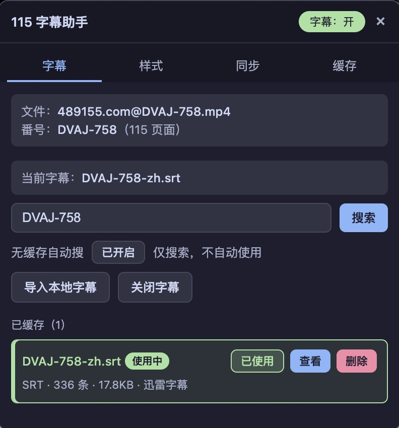
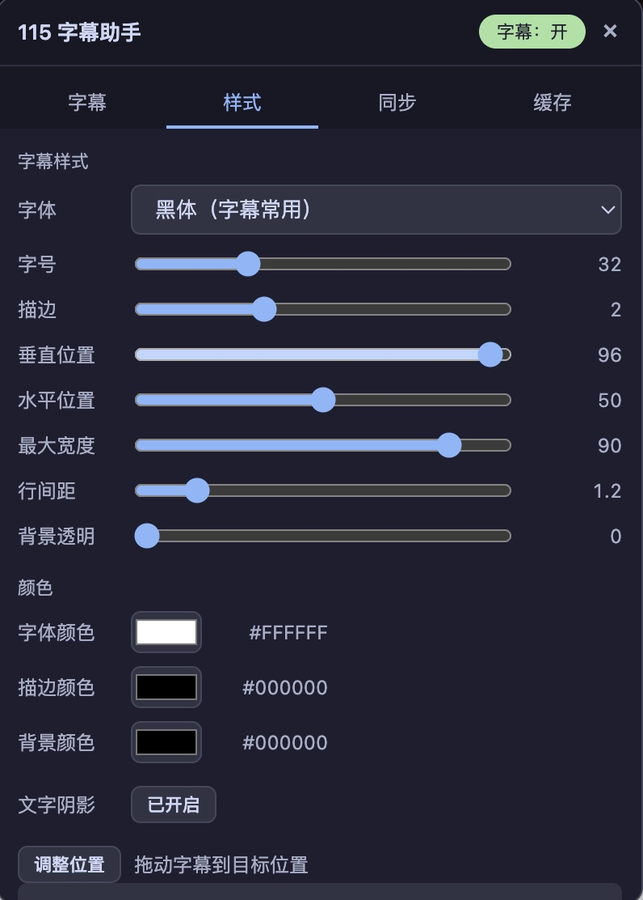
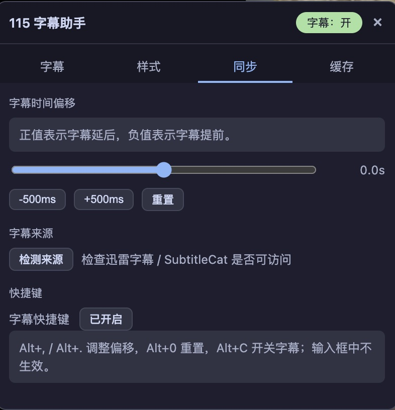
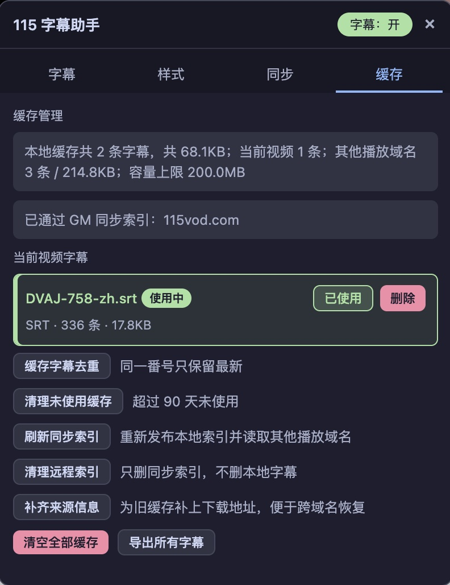

# 115 AutoSubtitle

115 网页播放器字幕助手 — 自动搜索、下载并叠加字幕到 115 网盘在线播放器上。

[](https://github.com/fireinrain/115-autosubtitle/releases/latest/download/115-subtitle-assistant.user.js)

---

## 功能介绍

- **自动识别视频番号**：从 115 播放页文件名中提取番号（如 `DVAJ-758`、`FC2-PPV-1234567`）
- **手动番号修正**：手动输入与自动识别不同时保存到当前视频，下次打开优先使用，面板标注“手动”
- **双播放页支持**：兼容旧版 `115vod.com` 与新版 `115.com/players/video/*` 播放器，控制栏「字幕」按钮后新增 CC 入口
- **双字幕源搜索**：并行搜索迅雷字幕（JSON API）+ SubtitleCat（HTML 解析），独立容错
- **搜索结果排序**：番号匹配、语言偏好、时长匹配权重自动排序；悬停标题可查看匹配原因
- **字幕选中即加载**：选中字幕后自动下载、解析、缓存并在视频上叠加显示
- **查看字幕内容**：支持在弹窗中预览字幕全文，关闭即退出
- **下载字幕文件**：一键下载 SRT 字幕文件到本地
- **本地字幕导入**：拖拽或选择本地 SRT/VTT 文件直接加载
- **时间轴偏移**：字幕整体提前或延迟，±500ms 微调 + 滑块
- **字幕样式**：字号、颜色、描边、位置、背景透明度自由调整；支持拖动字幕直接定位
- **本地缓存**：已选字幕存入 IndexedDB，下次打开同一视频自动恢复；没有缓存时才自动搜索，并缓存 15 分钟内的搜索结果
- **缓存管理**：按番号去重、按天/容量清理、ZIP 导出、清理远程同步索引、为旧缓存补齐来源信息
- **来源诊断**：同步页可检测迅雷字幕 / SubtitleCat 是否可访问；请求带并发/频率限制、一次退避重试与失败来源 60s
  冷却（手动搜索可强制重试）
- **缓存清理**：支持按天清理未使用缓存，超过容量上限时按最近使用时间自动清理
- **字幕快捷键**：Alt+, / Alt+. 调整偏移，Alt+0 重置，Alt+C 开关字幕；输入框内不生效
- **跨播放域名缓存索引**：通过 GM 存储同步缓存元数据；在另一个 115 播放域名打开同一视频时，可自动重新下载并恢复有来源信息的字幕；支持事件推送、手动刷新和清理远程索引

---

## 效果展示






## 快速安装

1. 安装 [Tampermonkey](https://www.tampermonkey.net/) 浏览器扩展
2. 点击下方按钮安装脚本：

[](https://github.com/fireinrain/115-autosubtitle/releases/latest/download/115-subtitle-assistant.user.js)

3. Tampermonkey 会自动弹出安装确认页，点击"安装"即可

---

## 如何使用

1. 打开 115 在线播放页面，支持两种地址：
    - 旧版：`https://115vod.com/?pickcode=...`
    - 新版：`https://115.com/players/video/<pickcode>?name=...`
2. 等待视频加载，脚本会自动识别文件名中的番号并搜索字幕
3. 播放器控制栏「字幕」按钮后会新增 **CC** 按钮，点击打开字幕助手面板
4. 搜索结果以列表展示，每条包含：标题、格式、语言、匹配分数
5. 点击操作按钮：

   | 按钮 | 功能 |
      |------|------|
   | **使用** | 下载字幕 → 解析 → 缓存 → 加载到播放器上叠加显示 |
   | **查看** | 下载字幕 → 弹出预览窗口显示前 30 条字幕内容 |
   | **下载** | 下载字幕文件 → 触发浏览器下载保存 |

6. 右侧面板可调整字幕样式（大小、颜色、描边、位置、背景透明度）
7. 时间偏移滑块可微调字幕与视频的同步

---

## 字幕来源

| 来源              | 方式             | 支持格式                  |
|-----------------|----------------|-----------------------|
| **迅雷字幕**        | JSON API，番号搜索  | SRT（ASS/SSA 可下载，暂不解析） |
| **SubtitleCat** | HTML 页面解析，中文优先 | SRT（zh-CN > zh-TW）    |
| **本地导入**        | 拖拽 / 点击选择      | SRT / VTT             |

所有在线请求通过域名白名单校验，防止恶意跳转。

> 当前解析器只实现 SRT / VTT。ASS / SSA 会被识别为对应格式，但 `parseSubtitle()` 会返回不支持错误；
> 该限制保留在已知限制中，不再列入功能规划。

---

## 已知限制

- 解析器当前只支持 **SRT / VTT**；ASS / SSA 尚未实现解析。
- 旧播放页的「网页全屏」已验证；「桌面全屏」仍待实测。若 `document.fullscreenElement` 是 `<video>`，overlay 不会显示，会弹出明确提示；暂未实现原生
  TextTrack 回退。
- 跨播放域名同步只同步元数据，不复制字幕正文：
    - 本地导入的字幕、旧版本缓存以及没有来源下载信息的记录不能自动恢复；
  - 支持 `GM_addValueChangeListener` 实时推送；不可用时仍保留面板打开时的 15s 轮询；
  - 旧缓存可通过缓存页「补齐来源信息」补上下载地址，只匹配 providerId + sourceId 完全一致的在线结果；
    - 下载地址可能过期，失败时会回退到自动搜索。
- 自动搜索会缓存 15 分钟内的结果（按番号 + 时长桶/文件名）；手动搜索始终重新请求。

完整清单、优先级和验收建议见 [`docs/optimization-backlog.md`](docs/optimization-backlog.md)。

---

## 开发

```bash
# 安装依赖
npm install

# 开发模式（启动 Vite dev server，Tampermonkey 加载 localhost 版本）
npm run dev

# 构建
npm run build

# 运行测试
npm test

# 类型检查
npm run typecheck

# Lint
npm run lint
```

开发时，先在 Tampermonkey 中安装 `dist/115-subtitle-assistant.user.js`，然后执行 `npm run dev`，将脚本的 `@require` 指向
`http://127.0.0.1:5173/src/index.ts` 即可实现热更新调试。

### 项目结构

```
src/
├── app/bootstrap.ts               启动入口，连接各模块
├── player/
│   ├── m115-video-adapter.ts      旧/新 115 播放器适配
│   ├── player-controller.ts       字幕加载与渲染循环
│   └── overlay-renderer.ts        Shadow DOM 字幕叠加层
├── identity/
│   └── video-identity.ts          文件名归一化与番号提取
├── providers/
│   ├── xunlei-provider.ts         迅雷字幕源
│   ├── subtitlecat-provider.ts    SubtitleCat 字幕源
│   └── local-provider.ts          本地字幕导入
├── search/
│   ├── search-engine.ts           并行搜索引擎
│   ├── search-cache.ts            自动搜索 15 分钟 TTL 缓存
│   ├── result-matcher.ts          结果评分排序
│   └── provider-manager.ts        Provider 注册与状态
├── subtitle/
│   ├── parsers.ts                 SRT/VTT 解析（ASS/SSA 待实现）
│   ├── timeline-engine.ts         时间轴引擎
│   ├── encoding-detector.ts       编码检测
│   └── preview.ts                 字幕预览/解码
├── storage/
│   ├── database.ts                IndexedDB 封装
│   ├── subtitle-repository.ts     字幕缓存 CRUD / 去重 / 元数据投影
│   ├── subtitle-zip.ts            缓存 ZIP 导出
│   └── metadata-sync.ts           跨播放域名 GM 元数据同步与事件推送
├── ui/
│   └── panel.ts                   控制面板 UI
├── settings/
│   ├── settings-service.ts        设置持久化与迁移
│   └── font-presets.ts            字幕字体预设
└── index.ts                       入口
```

测试在 `tests/`，构建与发布流程见 `.github/workflows/build-and-commit.yml`。

---

## 技术栈

- TypeScript + Vite
- vite-plugin-monkey（油猴脚本打包）
- Vitest + jsdom（单元测试）
- IndexedDB（本地缓存）
- Shadow DOM（字幕渲染隔离）

---

## 感谢

如果本脚本对您有帮助，欢迎在 GitHub 上给项目点赞/Star 或提交 Pull Request 。

## License

MIT